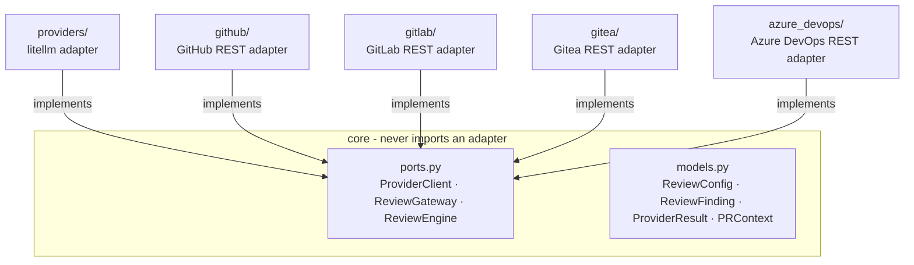
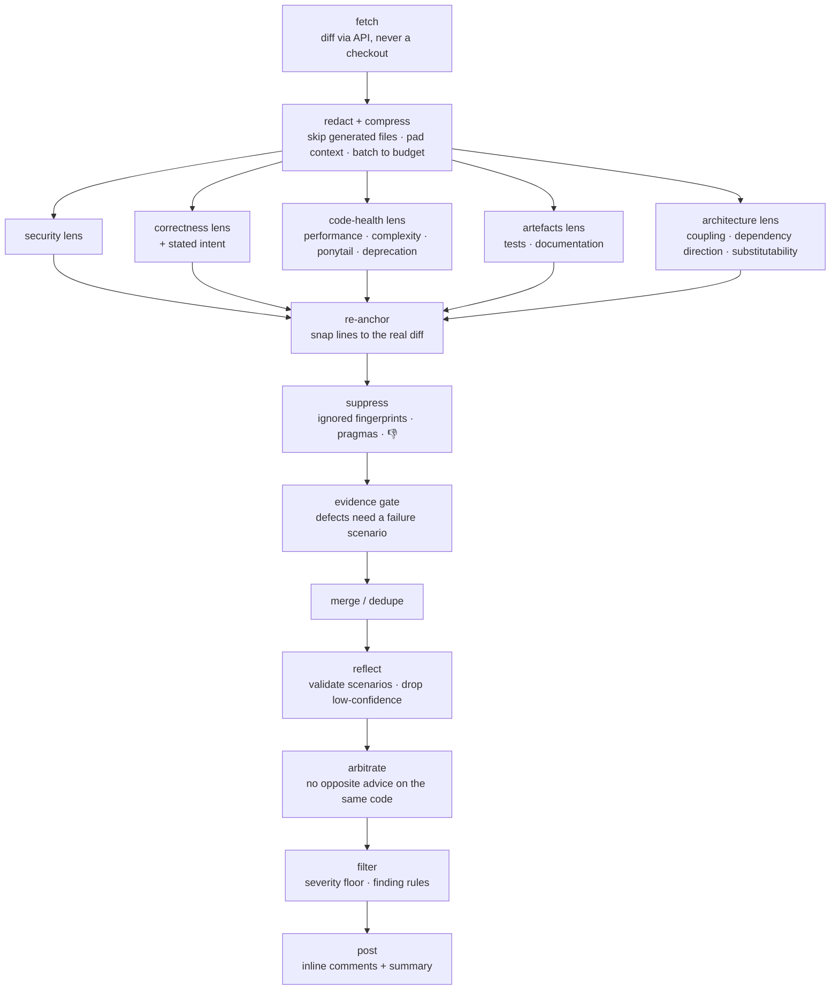

# Architecture

lgtmaybe uses a **hexagonal architecture**, also called ports and adapters. A
port is an interface the core defines. An adapter implements a port for a real
service. The core defines the ports in `core/ports.py` and never imports an
adapter. Tests swap in fakes without patching. A new model backend or code host
plugs in without touching the engine.

## Ports and Adapters



Two independent choices meet at these ports:

- which **model** reviews the code (`ProviderClient`);
- which **[code host](../reference/glossary.md#code-host)** the review is
  posted to (`ReviewGateway`).

Any combination works, because neither side knows about the other.

`core/ports.py` defines three structural protocols (`typing.Protocol`). An
adapter satisfies one by having the right methods. It never inherits from it.

- `ProviderClient` has one method. `complete(messages, model, **opts)` returns
  a `ProviderResult` (text plus token usage).
- `ReviewGateway` has three:
    - `get_pr_context()` fetches the change diff and metadata.
    - `post_review(findings, summary)` posts batched inline comments and a
      summary.
    - `post_issue_comment(body)` posts a standalone comment. `/ask` and failure
      notices use it, and it is the describe/diagram fallback.
- `ReviewEngine` has `review(ctx, cfg)`, which returns `(findings, summary)`.
  The engine takes a `PRContext` and never sees a gateway. That is why the
  local CLI can build a `PRContext` from `git` with no code host at all.

The ports are frozen. The providers,
[forge](../reference/glossary.md#forge) adapters, engine and CLI all build
against these signatures, so change one only deliberately. `GitHubGateway`
survives as an alias of `ReviewGateway`, for adapters written before lgtmaybe
supported more than one host.

## Code Hosts (Forges)

Internally lgtmaybe calls a code host a **forge**. This keeps it distinct from
a model *[provider](../reference/glossary.md#provider)*. `core/forge.py` holds
the host-specific logic that lives outside the adapters:

- a `Forge` enum;
- a `PRLocator` (forge, host, repo, number) parsed from a change-request URL;
- the environment variable that holds each host's token.

The URL is all lgtmaybe needs:

| URL shape | Forge | Token |
|---|---|---|
| `github.com/org/repo/pull/42` | GitHub | `GITHUB_TOKEN` |
| `gitlab.com/group/sub/project/-/merge_requests/42` | GitLab | `GITLAB_TOKEN` |
| `gitea.example.com/org/repo/pulls/42` | Gitea | `GITEA_TOKEN` |
| `dev.azure.com/org/project/_git/repo/pullrequest/42` | Azure DevOps | `AZURE_DEVOPS_TOKEN` or `SYSTEM_ACCESSTOKEN` |

lgtmaybe parses the host from the URL rather than assuming it, because
self-hosted GitLab and Gitea are the normal case. `cli._GATEWAY_BUILDERS` maps
the resolved forge to its adapter.

### Required Surface vs Optional Capabilities

`ReviewGateway` is deliberately three methods. Everything richer is an optional
`Supports*` protocol. The CLI probes for each one and skips it when absent. So
an adapter is useful long before it is complete. It can also be honest about
what its host cannot do, instead of failing at run time.

| Capability | GitHub | GitLab | Gitea | Azure DevOps |
|---|---|---|---|---|
| `SupportsFileContents`: read head text for context | ✅ | ✅ | ✅ | ✅ |
| `SupportsDescribe` / `SupportsDiagram`: upserted comments | ✅ | ✅ | ✅ | ✅ |
| `SupportsConversation`: read existing comments | ✅ | ✅ | ✅ | ✅ |
| `SupportsLabels` | ✅ | ✅ | ✅ | not yet |
| `SupportsChecks`: check run / commit status | ✅ | ✅ | ✅ | not yet |
| `SupportsThreadResolution`: auto-resolve a fixed finding | ✅ GraphQL | ✅ REST | ✗ no API | not yet |
| `SupportsIncremental`: review only new commits | ✅ | ✅ | ✗ no compare diff | not yet |
| `SupportsScanManifests`: fetch dependency manifests for scanning | ✅ | ✅ | ✅ | ✅ |
| `SupportsPermissions`: only writers run slash commands | ✅ | ✗ no slash commands | ✅ | ✗ no slash commands |
| `SupportsFeedback`: learn from 👎 reactions | ✅ | ✅ award emoji | ✗ | not yet |
| `SupportsBaseCheckout`: clone base for symbol lookup | ✅ | ✗ | ✗ | not yet |

`tests/test_ports.py` asserts the GitHub adapter satisfies every capability.
The GitLab, Gitea and Azure DevOps tests assert those adapters do **not** claim
what they cannot serve. That keeps this table honest.

### Where the Hosts Differ

Gitea is close to GitHub; GitLab and Azure DevOps are not.

- **GitHub** batches every inline comment into one review object. It resolves
  threads over GraphQL.
- **Gitea** mirrors GitHub's API, but a submitted review is immutable. So the
  summary lives in an ordinary issue comment, which can be edited. The adapter
  de-duplicates findings *before* posting, by reading the hidden ids already on
  the pull request.
- **GitLab** has no batched review object. Each finding is its own
  **discussion**, positioned by old/new path and line plus the merge request's
  `base_sha`/`start_sha`/`head_sha`. Threads resolve over plain REST. Its
  compare API returns per-file patches and no "ahead" status. So the adapter
  reassembles the increment into a unified diff. It checks from the commits'
  parent ids that the new head builds on the last reviewed one. It also works
  out the "lines moved" signal GitLab doesn't expose, from the diff since each
  discussion was posted.
- **Azure DevOps** serves no unified diff. The adapter lists the latest
  iteration's changed files against the merge base. It fetches each file's text
  on both sides. It renders the diff with `core/diffbuild.py`, so the shared
  parser reads it like any other. Each finding is its own thread, positioned by
  `threadContext`. The summary is a general thread edited in place.

lgtmaybe uses GitHub's `RIGHT`/`LEFT` side vocabulary internally. Each adapter
translates it at its boundary:

- `new_position`/`old_position` on Gitea;
- `new_line`/`old_line` on GitLab;
- right-file/left-file ranges on Azure DevOps.

### Entrypoints

GitHub and Gitea share one entrypoint. Gitea Actions reimplements the GitHub
Actions runtime, so the same `action` command and container work on both. The
only variable that differs is `GITHUB_SERVER_URL`, which Gitea points at your
own instance.

GitLab CI has neither an event payload file nor `INPUT_*` variables. So it gets
its own `gitlab-ci` command, which reads GitLab's predefined `CI_*` variables.
Everything downstream (locator, gateway registry, engine) is shared. There is
no `synchronize` action to key on, so `gitlab-ci` treats an unset `incremental`
as on. The first pipeline has no
[watermark](../reference/glossary.md#watermark) yet, so it is a full review
anyway.

Azure Pipelines is in the same position, so `azure-pipelines` reads its
predefined `SYSTEM_*` and `BUILD_*` variables.

## Review Pipeline

The engine runs a pipeline of composable stages:

```
fetch → redact → compress → prompt → parse → re-anchor → suppress
      → evidence gate → merge/dedupe → reflect → arbitrate → filter → post
```

The prompt/parse stage [fans out](../reference/glossary.md#fan-out): it makes
one concurrent model call per review [lens](../reference/glossary.md#lens).
The findings then funnel back into a single stream:



The five lens calls shown are the default `fast` grouping. The same five run on
every provider; worker count decides only whether they overlap. The `full`
[preset](../reference/glossary.md#preset) fans out one call per category. A
[spec lens](../reference/glossary.md#spec-lens) (when a committed spec matches
the PR) and any custom lenses join the same fan-out.

1. **fetch**: `ReviewGateway.get_pr_context()` retrieves the change diff and
    metadata from the forge's API. lgtmaybe never checks out or executes the
    change's code. It treats the diff as untrusted input throughout.

2. **redact + compress**: this stage prepares the diff for the model.

    - It [redacts](../reference/glossary.md#redaction) secrets from the diff
      before anything else sees it.
    - It skips generated files, lockfiles, minified assets and vendored code.
    - It then applies the `include_paths` / `exclude_paths` filters and the
      `max_file_diff_lines` and `max_files` caps.
    - It pads each remaining [hunk](../reference/glossary.md#hunk) with
      surrounding lines from the file's head revision. The gateway fetches
      those lines, never a checkout. `context_lines` and the token budget cap
      the padding.
    - It batches the result to fit `max_input_tokens`. When that is left at its
      default, it is first capped at what the model's context window can take.
    - With `recursive` on (the default), it walks a single file over budget
      hunk by hunk instead of sending it whole.

    The padded diff is for the model only. Inline-comment positions are rebuilt
    from the **real** diff at post time. So a finding on a padding line maps to
    nothing and is dropped rather than mis-posted.

3. **prompt + parse**: this stage **fans out one model call per review lens**,
    and `preset` decides the lens set. `fast` (the default) covers all ten
    everyday categories in **five calls**, one per concern:

    - security;
    - correctness, with stated intent when present;
    - code health: performance, complexity, ponytail, deprecation;
    - artefacts: tests, documentation;
    - architecture.

    `full` runs one call per category. Every (batch, lens) task shares **one
    `ThreadPoolExecutor`** over the synchronous provider port. It is sized by
    `max_concurrency` (default 6 for every provider, local included), so
    batches never wait on each other.

    Each call starts with a shared
    [cacheable prefix](../reference/glossary.md#prompt-cache): a
    lens-independent system preamble, then the wrapped diff. The lens-specific
    instructions follow as the final user block.

    Some routes take an explicit cache breakpoint: anthropic, bedrock
    Claude/Nova, vertex Claude and Gemini, zai GLM, and openrouter's
    claude/gemini/glm/minimax families. On those, lgtmaybe marks the prefix
    with `cache_control`. Backends that cache automatically (OpenAI, Azure,
    DeepSeek) need no marker. On a cache-capable route, every call after a
    batch's first reads the preamble and diff from cache. Other routes get the
    blocks merged into one plain message and make no caching promise. On big
    diffs a warm-up primer runs the first lens alone. That way a concurrent
    first wave doesn't pay for several cache writes.

    Each lens prompt asks for JSON matching the `ReviewFinding` schema (`path`,
    `line`, `side`, `severity`, `title`, `body`, `failure_scenario`,
    `suggestion`, `anchor`). It also carries
    [prompt-injection](../reference/glossary.md#prompt-injection) defence
    instructions. Pydantic parses and validates each response. A reply that
    does not parse is sent back once for repair (`repair_unparseable`, default
    on). A call that still fails is named in the summary's incomplete-results
    notice, rather than silently discarded.

    With `mid_review_retrieval` on (default **off**), a lens has a third option
    besides asserting or hedging a cross-file claim: **ask to read the code**.
    Alongside its findings it may return `needs`, the file paths or symbols it
    must see. The engine fetches them through the same read-only, redacting
    boundary that [reflection](../reference/glossary.md#reflection) uses (never
    a checkout). It then re-runs *that one lens* with the text added to its own
    uncached block. The shared prefix is untouched, so the batch's other lenses
    still read it from cache.

    This retrieval is bounded to **one hop**:

    - the re-run cannot defer again;
    - it fetches at most five files within a quarter of `max_input_tokens`;
    - a deferral that arrives past the review deadline or token budget is
      skipped with the usual incomplete-results notice.

    Both calls' findings are merged, so a deferral can only add findings. The
    cost is up to one extra model call per (batch, lens), which is why it ships
    off.

4. **re-anchor**: `_snap_findings` rebinds each finding's `line` to the changed
    line whose content matches the finding's verbatim
    [`anchor`](../reference/glossary.md#anchor). It does this rather than trust
    the model's line arithmetic. A finding whose anchor matches nothing is
    marked `anchored=False`. It must clear `unanchored_min_severity` (default
    `high`). It is then demoted to the review body instead of posted on a
    guessed line.

5. **suppress**: findings a team has marked known-fine are dropped before they
    cost any reflection tokens. Three things suppress a finding:

    - its fingerprint is in `ignore_fingerprints`;
    - a `# lgtmaybe: ignore` pragma sits on (or directly above) the flagged
      line;
    - a reviewer reacted 👎 to it on an earlier run (`learn_feedback`).

    Neither a 👎 nor a pragma (which the PR's author writes) suppresses a high
    or critical security finding. Only `ignore_fingerprints` in trusted config
    can.

6. **evidence gate**: security, correctness, deprecation and performance
    findings must carry a concrete `failure_scenario`. That means the trigger,
    the changed behaviour, and the observable impact. The rule applies
    regardless of the severity the model chose, so lowering a finding to `low`
    cannot bypass it. Gap and maintainability findings (tests, documentation,
    complexity) do not need a runtime failure. A fast-preset code-health
    finding the model left unattributed does, since it may be a performance or
    deprecation one.

7. **merge/dedupe**: findings from every lens are merged and de-duplicated by
    `_dedupe`. It keys on path/line/side, and scan findings on their title too,
    so distinct tool hits never merge. It runs after the two filters above. So
    a copy they would drop never displaces the finding that shares its line.

8. **reflect**: a self-reflection pass (`engine/reflect.py`) asks the provider
    to audit its own findings. It scores each 0-10 and drops the ones it marks
    low-confidence, plus any below `min_confidence`. If the verdict can't be
    parsed, every finding is kept. `--no-reflect` skips the pass. The auditor
    also tries to disprove each claimed failure scenario against the diff and
    the grounded file text.

    Sometimes the auditor would drop a finding *only* because it can't see code
    outside the diff. Then it **defers** by naming what it needs: a file path or
    a **symbol**. A path is fetched read-only (`get_file_contents`). A symbol is
    located by **ast-grep** (`engine/astgrep.py`), which structurally searches
    a corpus for the file that *defines* it. The corpus is the local worktree
    for the CLI, or a read-only shallow clone of the trusted **base** branch on
    GitHub. That file is fetched through the same read-only boundary. The
    auditor then re-judges with the real definition in front of it, instead of
    guessing about an unseen guard or base class.

    This stays inside the fork-safety model: ast-grep only *parses* the corpus
    (never executes it), and the base clone is never the PR head.
    [Symbol resolution](../reference/glossary.md#symbol-resolution) needs the
    bundled `ast-grep` binary and a corpus. Without either it falls back to the
    path-only fetch. `--no-symbol-resolution` disables it. It is bounded by the
    same hop and file caps as the path fetch.

    The auditor is also the first referee for opposing advice. Two findings
    from lenses on the precedence ladder may point opposite ways about the same
    code. Then it keeps the higher-ranked one.

9. **arbitrate**: this is the deterministic referee behind it
    (`engine/conflicts.py`). It also runs under `--no-reflect`. Some lens pairs
    are declared opposed: [ponytail](../reference/glossary.md#ponytail) against
    correctness, security or architecture. A finding from such a pair within
    three lines of a higher-ranked one is dropped. Each drop is logged with the
    finding and the lens that outranked it. See
    [When Lenses Disagree](what-gets-reviewed.md#when-lenses-disagree).

10. **filter**: findings below `min_severity` are dropped. Then any
    `finding_rules` apply, which drop or re-grade findings by path, lens, title
    or severity.

11. **post**: findings are posted as one batched review on GitHub. Per-host
    differences are in
    [What gets reviewed](what-gets-reviewed.md#how-each-host-posts).

    A hidden marker identifies lgtmaybe's summary. A re-run at the same commit
    edits it in place. A completed review at a new commit posts a fresh
    summary, leaving the older ones as history. Each inline comment carries two
    hidden per-finding ids, so a re-run never re-posts a finding it already
    made.

    On a re-run, conversations whose finding is gone **and** whose thread
    GitHub marks outdated are replied to and resolved (`resolve_fixed`, default
    on). The REST review API can't resolve a thread, so this step uses GitHub's
    GraphQL API. It is best-effort: a failure never blocks the review.

## Provider Strategy and Factory

Provider selection uses the **strategy pattern**: one interface with
interchangeable implementations. `--provider` picks a `ProviderClient`
strategy, and a small factory (`providers/factory.py`) builds it. The litellm
library normalises every provider to one `completion()` call. So the factory
stays small and the engine stays provider-agnostic.

Credential resolution is a **chain of responsibility**
(`providers/credentials.py`): each provider knows how to find its own
credentials. That is an API key,
[ambient cloud credentials](../reference/glossary.md#ambient-credentials), or
none for ollama. lgtmaybe never stores or logs credentials.

## Reliability: Retries, Timeouts and Concurrency

The provider wrapper (`LiteLLMProvider`) and the engine cooperate. A flaky
network recovers, but a dead-end failure surfaces fast.

- **Retries are classified, not blanket.** Transient failures are retried with
    exponential backoff and jitter, up to four attempts. These count as
    transient:

    - capacity rate limits (`429 rate_limit_exceeded`);
    - the provider's own connect/read timeouts;
    - connection errors, such as an ollama server still warming up;
    - 5xx responses.

    **Permanent** failures are not retried:

    - bad credentials (`AuthenticationError`);
    - malformed or unsupported requests (`BadRequestError`, including
      content-policy blocks);
    - unknown models (`NotFoundError`);
    - denied permissions;
    - **quota/billing** limits (`429 insufficient_quota`).

    A quota error can never succeed on retry. Across every lens it would only
    turn an instant "out of credit" into many minutes of wasted runner time. So
    lgtmaybe raises it immediately. An optional `fallback_model` is still tried
    once.

- **A blown wall clock is permanent too.** When a call outlives lgtmaybe's own
    per-request timeout, a retry would send the identical request to the
    identical model against the identical budget. It would fail the same way
    after another full timeout. So the wall timeout is raised after one
    attempt, and the failure reports how many attempts it used. The
    `fallback_model` is a different request, so it still gets its turn with a
    fresh budget.

- **Retried smaller, not repeated.** A wall timeout says something about the
    *payload*, and the payload is the one thing the engine can change. So the
    engine splits the batch: it halves it by file, or by hunk for a
    single-file batch. Each piece is reviewed with a fresh budget. A slow lens
    no longer discards the whole batch's review.

    The split goes **one** level deep. A piece that times out again fails with
    no further split. So a model that cannot answer at any size can't cascade
    through the review budget. The summary says when a batch had to be shrunk.
    A silent split would hide that every run is at the edge of what the model
    can finish in time.

- **A second model is the last remedy for a
    [truncation](../reference/glossary.md#truncation), not the first.** A
    truncated lens has two remedies that stay on the model you chose:

    - shrink the payload (the split above) when the *answer* outgrew the
      output ceiling;
    - lower `reasoning_effort` when the *thinking* did. If the lower setting
      also spends the ceiling on thinking, one more call runs with reasoning
      switched off (`disable_reasoning`). Some models treat effort as an on or
      off switch, so a lower setting alone changes nothing.

    Both are cheap, and both act on what the token counts say went wrong.
    Switching to `fallback_model` says nothing about the failure. It re-sends
    the same request at the same ceiling and hopes a second model finishes it.
    So it runs only after the targeted remedy has failed. It runs once for the
    whole batch, not once per split piece. The adapter still rescues every
    other kind of failure itself. Either way, the summary names the lens and
    the model that answered it. A review the primary model could not finish
    must not read like one it did.

    Reach for this rule before routing on diff size. Truncation does not track
    size. In our measurements a fifteen-line diff truncated at the same ceiling
    as a large multi-file one, because the ceiling goes on thinking. A size
    threshold spends the strong model on diffs that were already fine. A
    fallback keyed on the failure costs nothing until one happens.

- **A rate limit waits on its own, slower ladder.** The general ladder starts at
    a tenth of a second, which suits a blip such as a connection reset. A
    capacity 429 is not a blip. Gateways that meter an API key meter it *per
    minute*. A ladder that fits four attempts into a few seconds lands them all
    in the same window, where they fail identically.

    So rate limits back off on a 20s-60s ladder. They prefer the server's own
    **`Retry-After`** when it sends one, in either RFC form. That wait is
    clamped at 120s, so a gateway asking for an hour can't eat the run's wall
    clock. Both ladders stay inside the 2.5× retry budget below. The budget is
    checked against the *upcoming* wait, so a backoff that would exceed it ends
    the call instead of sleeping.

- **A call that failed on the provider gets one more go.** Once the fan-out has
    drained, the calls that failed *provider-side* are re-run once, in a narrow
    pool of their own. Without this, a single flaky call voided that lens's
    findings for the round until somebody re-ran by hand.

    Nothing else is re-run, because a second attempt would repeat the same
    failure at full price:

    - unparseable output returns the same answer at temperature 0;
    - a truncation hits the same ceiling;
    - a batch the split already retried has had the one retry that can help;
    - a dead key or spent quota won't fix itself mid-review;
    - a ceiling you set is not a fault to retry past.

    Every rescue re-checks the deadline, the token budget and the interrupt
    first. A healthy run costs **zero** extra calls.

- **One retry layer.** litellm's own internal retry loop is disabled
    (`num_retries=0`), so failures aren't ground through two stacked backoff
    layers. lgtmaybe owns the retry policy in one place.

- **Per-request timeout and a shared retry budget.** Every model call carries
    a timeout:

    - 600s for direct cloud providers;
    - 1800s for providers that may front a slow model: ollama,
      openai-compatible (local servers) and openrouter (a gateway to arbitrary
      models, including slow reasoning ones).

    For ollama and openai-compatible, the default is multiplied by the fan-out
    width. A single-slot local server queues the other calls while their clocks
    run. `timeout` / `--timeout` overrides all of this. All attempts for one
    call share a wall-clock budget of **2.5× the timeout**. So a flaky model
    can't burn four full timeouts plus backoff per lens.

    lgtmaybe's own workflows also set a job-level `timeout-minutes` (75) above
    `max_review_seconds`. So the soft deadline, which still posts partial
    findings, fires before the runner kills the job. Do the same in yours. If
    the runner does cut the job short, the CLI's signal handler is the backstop
    (below).

- **A whole-review deadline.** `max_review_seconds` (default 3600, `0`
    disables) is a soft ceiling on the run. Once it passes, queued model calls
    are skipped, in-flight ones finish and their findings post, and the summary
    carries an explicit incomplete-results notice. It can never produce a
    silent LGTM: a run where every call failed or was skipped still fails
    loudly.

- **A termination signal does the same thing.** The CLI installs a
    SIGINT/SIGTERM handler that sets the deadline's state. So a job the runner
    cancels or times out stops dispatching model calls. It posts what it
    already has, with a notice naming the interruption. Only the CLI entrypoint
    installs the handler. Importing lgtmaybe as a library never touches your
    signal handlers. The handler restores the previous handler as it fires, so
    a second signal still kills the process.

- **Incompleteness is visible on the PR, not only in the log.** A failed lens
    call of *any* kind raises the incomplete-results notice: a per-call
    timeout, a provider error, or unparseable output. The notice names the
    lenses it lost and why. A missing security lens and a missing
    documentation lens are the same count and very different news. The engine
    also stamps a hidden `<!-- lgtmaybe-incomplete -->` marker.

    Later findings arrive as separate review comments, while the first run's
    summary is only edited in place. So an incomplete run also posts the notice
    as its own PR comment. A review that failed outright does the same.

    The summary also carries a hidden `<!-- lgtmaybe-lenses:… -->` list of the
    lenses that completed every call. A gate that wants "every lens ran" can
    require the set it expects. It need not infer it from the absence of a
    notice. A matched spec that did not fit the spec budget is named the same
    way. A spec lens that should have run and did not is a gap, not a no-match.

- **A diff the host will not serve is a review that did not happen.** GitHub
    answers the diff request with 406 once a PR passes 300 files or 20,000
    lines. lgtmaybe reads PR content through that API only, never a checkout.
    So there is nothing to review, and no retry will change it. The run:

    - posts a "not reviewed" notice quoting GitHub's reason, with a hidden
      `<!-- lgtmaybe-skipped -->` marker;
    - stamps nothing complete;
    - exits zero.

    It is not a failure: a red job for a PR the reviewer could never read only
    teaches people to ignore red jobs. It is never an LGTM either. The fix is a
    smaller PR; no reviewer setting moves the host's limit.

- **One global fan-out pool.** Every (batch, lens) call runs through a single
    `ThreadPoolExecutor` sized by `max_concurrency`. The default is **6
    workers** for every provider. An extra worker can cut a full-latency wave
    off the wall clock. But the fan-out shares *one* API key. Past some width,
    the burst rate-limits itself against a gateway that meters per minute.
    Raise it if your rate tier is generous.

    Local providers get the same 6. A default ollama serves one request at a
    time, but that is a property of the *server*. One that can batch would be
    capped for nothing. One that can't loses nothing by having work queued,
    because ollama queues up to `OLLAMA_MAX_QUEUE` rather than failing.

    Local throughput is decided by `OLLAMA_NUM_PARALLEL`, llama.cpp's `-np` or
    vLLM's batching. Raising those costs memory per slot; see
    [running locally](../how-to/run-locally-with-ollama.md). Drop
    `max_concurrency` to 1 for a very slow local model, where six queued calls
    could each wait out the timeout. The pool is shared across batches. So wall
    time is `ceil(batches × lenses / workers)` call-latencies rather than
    `batches × ceil(lenses / workers)`.

## Dependency Injection

The engine receives its ports by injection: it is handed them rather than
building them itself. `LLMReviewEngine` takes a `ProviderClient`, plus optional
file-fetch and symbol-resolver callables. `review()` takes a `PRContext`. In
production the CLI wires the real adapters. In tests, the fakes in
`tests/fakes/` (`FakeProvider`, `FakeGitHub`, `FakeEngine`) drop in directly.
So swapping a port never needs patching.

## Why Not a Plugin Framework or Event Bus

We considered both and skipped them. The current providers fit cleanly in a
strategy and factory. A plugin registry would add indirection with no present
benefit. An event bus would complicate the linear pipeline without enabling any
feature the product needs. Either can be revisited if a concrete requirement
arises.
