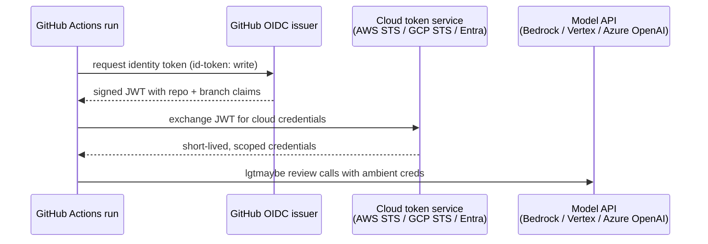

# Auth Model

lgtmaybe supports seven hosted [providers](../reference/glossary.md#provider)
plus local ollama. It also has an `openai-compatible` escape hatch for any
server that speaks the OpenAI `/v1` wire format (DeepSeek's API, llama.cpp, LM
Studio, vLLM).

The design principle is **no static cloud credentials**. A static credential is
a long-lived key you store and rotate by hand.

- Cloud providers use [ambient](../reference/glossary.md#ambient-credentials),
  short-lived tokens that the environment already provides.
- Key-based SaaS providers (openai, anthropic, openrouter, zai) need an API key.
  The key lives in a secret store, never in committed config.
- The `chatgpt` provider uses a ChatGPT Plus or Pro subscription instead of a
  key. You sign in once on your own machine, so it is for local reviews only.
- Azure sits between the two. It accepts a resource key but falls back to
  ambient Entra (Azure AD) credentials. It always needs the resource endpoint
  (`AZURE_API_BASE`), because each Azure OpenAI deployment lives at its own URL.

## Why Keyless for Cloud

Static credentials, such as an AWS access key pair or a GCP service-account
JSON file, have a long lifetime and broad scope. If one leaks from a CI log, a
misconfigured secrets manager, or a compromised runner, an attacker keeps
access until someone rotates the key by hand.

[OIDC](../reference/glossary.md#oidc) (AWS),
[Workload Identity Federation](../reference/glossary.md#wif) (GCP), and
federated credentials on an Entra app (Azure) issue tokens that:

- expire in minutes, not years;
- are scoped to a single workflow run;
- are never stored as static secrets, so there is no long-lived key to leak;
- are tied to the specific repository and branch through the OIDC claims.

The exchange has the same shape on all three clouds, and no secret ever enters
the workflow:

In the GitHub Action, pass `aws_role_arn`, `gcp_wif_provider` or
`azure_client_id` and the action runs this exchange for you. The workflow needs
`permissions: id-token: write`.

For these reasons, Bedrock and Vertex accept only ambient credentials:
`--api-key` is ignored for them. Azure defaults to the same keyless path
(GitHub OIDC to Entra, through `azure-identity`'s `DefaultAzureCredential`) but
also accepts a resource key for teams that can't adopt federation yet.

## Chain of Responsibility

When lgtmaybe starts, it resolves credentials for the selected provider. Each
provider has its own rule for where to look:

1. **Bedrock** hands credential discovery to the AWS SDK, which finds GitHub
   OIDC role credentials, `~/.aws` profiles, environment variables, or an
   ECS, EKS or EC2 role. lgtmaybe never asks for a key, and missing
   credentials surface as an error from the first model call.
2. **Vertex** checks for ambient GCP credentials first: Workload Identity
   Federation, Application Default Credentials from
   `gcloud auth application-default login`, or a project set in the
   environment. Failing those, it asks `google-auth`, which also finds the
   metadata-server credentials of GCE, GKE Workload Identity, Cloud Run and
   Cloud Build. If there are none, lgtmaybe fails immediately with a message
   explaining how to authenticate. It never falls back to a key.
3. **Azure** always needs the resource endpoint (`AZURE_API_BASE` or
   `--api-base`). It uses a key when one is supplied (`AZURE_API_KEY` or
   `--api-key`). Otherwise it goes keyless and mints an Entra token from
   ambient credentials: GitHub OIDC federation in CI, or `az login` or a
   managed identity locally. The token is refreshed as it nears expiry, so a
   review that runs past an hour keeps working. Keyless needs the
   `azure-identity` package (`pip install 'lgtmaybe[azure]'`; the Action image
   includes it). With neither a key nor an ambient credential, lgtmaybe fails
   at start-up with a message naming both options and the SDK's own reason.
4. **ollama** needs no credentials. `--api-base` points it at the server and
   defaults to `http://localhost:11434`.
5. **zai** (GLM / Zhipu AI) needs `ZAI_API_KEY` or `--api-key`. Without an
   endpoint override, litellm's native `zai/` route targets the international
   endpoint; set `--api-base` or `ZAI_API_BASE` for the China or coding-plan
   endpoint.
6. **openai-compatible** always needs the endpoint (`--api-base` or
   `OPENAI_COMPATIBLE_API_BASE`), since choosing your own is the point. The key
   is optional. Hosted endpoints like DeepSeek take one (`--api-key` or
   `OPENAI_COMPATIBLE_API_KEY`). Local servers (llama.cpp, LM Studio, vLLM)
   need none, and lgtmaybe sends a harmless placeholder key because the
   underlying OpenAI client rejects an empty one.
7. **chatgpt** needs a stored sign-in from `lgtmaybe login chatgpt`. litellm
   keeps the token at `~/.config/litellm/chatgpt/auth.json` (or under
   `CHATGPT_TOKEN_DIR`) and refreshes it. lgtmaybe renews it once at start-up,
   before the review sends its calls in parallel. With no sign-in, or one that
   cannot be renewed, lgtmaybe fails with a message naming the login command. A
   review never starts the browser sign-in itself.
8. **openai, anthropic and openrouter** read the key from `--api-key`, or else
   from `OPENAI_API_KEY`, `ANTHROPIC_API_KEY` or `OPENROUTER_API_KEY`. With
   neither, lgtmaybe fails with a message naming the variable to set.

!!! note "In the GitHub Action, use the `api_key` and `api_base` inputs"

    The Action's container receives only its `INPUT_*` variables and the
    cloud-auth `AWS_*`, `GOOGLE_*`, `CLOUDSDK_*` and `AZURE_*` variables. A
    provider key set as a step `env:` variable such as `ANTHROPIC_API_KEY` does
    not reach it, so pass the key with `api_key: ${{ secrets.… }}` and any
    endpoint with `api_base`.

## Provider Auth Summary

| Provider | Credential type | How to supply |
|---|---|---|
| openai | API key | `OPENAI_API_KEY` env var or `--api-key` |
| anthropic | API key | `ANTHROPIC_API_KEY` env var or `--api-key` |
| openrouter | API key | `OPENROUTER_API_KEY` env var or `--api-key` |
| zai | API key (+ optional endpoint) | `ZAI_API_KEY` env var or `--api-key`; optional `ZAI_API_BASE` / `--api-base` for the China / coding-plan endpoint |
| chatgpt | Subscription sign-in (OAuth token) | `lgtmaybe login chatgpt` once per machine; local reviews only |
| bedrock | Ambient AWS creds | GitHub OIDC role or local `~/.aws`; IAM needs only `bedrock:InvokeModel*` |
| vertex | Ambient GCP creds | GitHub WIF or local ADC (`gcloud auth application-default login`) |
| azure | Ambient Entra creds (keyless) or API key, + endpoint | GitHub OIDC to an Entra federated credential, or local `az login` / managed identity; or `AZURE_API_KEY`. Always with `AZURE_API_BASE` / `--api-base` |
| ollama | None | `--api-base` pointing at the local or remote server (default `http://localhost:11434`) |
| openai-compatible | Optional key, + endpoint | `--api-base` / `OPENAI_COMPATIBLE_API_BASE` (e.g. `https://api.deepseek.com/v1` or `http://localhost:8000/v1`); key via `--api-key` / `OPENAI_COMPATIBLE_API_KEY`, or none for keyless local servers |

## Code-Host Auth

Everything above authenticates lgtmaybe to a **model provider**. Reading the
diff and posting the review need a separate credential for the
[code host](../reference/glossary.md#code-host). The host in the change-request
(pull or merge request) URL decides which one:

| Host | Variable | What it needs |
|---|---|---|
| GitHub | `GITHUB_TOKEN` | `contents: read` and `pull-requests: write`. The Action's default token is enough |
| GitLab | `GITLAB_TOKEN` | A project access token with the `api` scope, Developer role or above |
| Gitea, Forgejo | `GITEA_TOKEN` | A token with `write:repository`, `write:issue` and `read:user` |
| Azure DevOps | `AZURE_DEVOPS_TOKEN`, else `SYSTEM_ACCESSTOKEN` | A personal access token with Code (Read & write) scope, or the pipeline's own token with *Contribute to pull requests* granted to the build service |

These are always tokens. There is no keyless path to a code host, and lgtmaybe
does not attempt one. The token is read from the environment only and, like a
provider key, is never written to `.lgtmaybe.yml` or logged.

!!! note "Keyless cloud auth needs GitHub or Forgejo"

    Bedrock, Vertex, and Azure go keyless by exchanging the CI job's own OIDC
    token. The GitHub Action does it in its own steps. On Forgejo Actions, the
    container does it, when the job sets `enable-openid-connect: true` (see
    [Review on Forgejo](../how-to/review-on-forgejo.md#keyless-bedrock-azure-and-vertex)).
    GitLab CI, Gitea Actions and Azure Pipelines have no equivalent exchange
    wired up, so on those hosts use an API-key provider, or `ollama` against a
    runner-local model, which needs no credential at all.

## Least-Privilege IAM

For Bedrock, the minimum [IAM](../reference/glossary.md#iam) policy is `bedrock:InvokeModel` and (if streaming)
`bedrock:InvokeModelWithResponseStream` on the specific model ARN. No other AWS
permissions are needed or requested.

For Vertex, `roles/aiplatform.user` on the project is enough. Do not use
`roles/editor` or `roles/owner`.

For keyless Azure, the Entra app needs only the **Cognitive Services OpenAI
User** role on the Azure OpenAI resource (enough to call deployments, not to
manage them) plus a federated credential scoped to your repository. No owner or
contributor role is required.

## API Keys in Secrets, Not Config

Every API key (openai, anthropic, openrouter, zai, an Azure resource key, or a
hosted `openai-compatible` key) belongs in a secret store: a GitHub Actions
secret, a GitLab masked CI/CD variable, or a Gitea Actions secret. Never commit
one to `.lgtmaybe.yml` or any other file in the repository. lgtmaybe does not
log or display key values.
