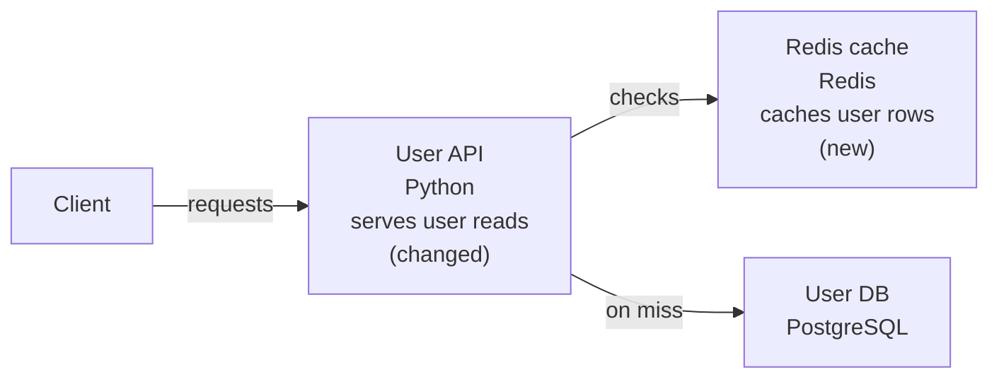
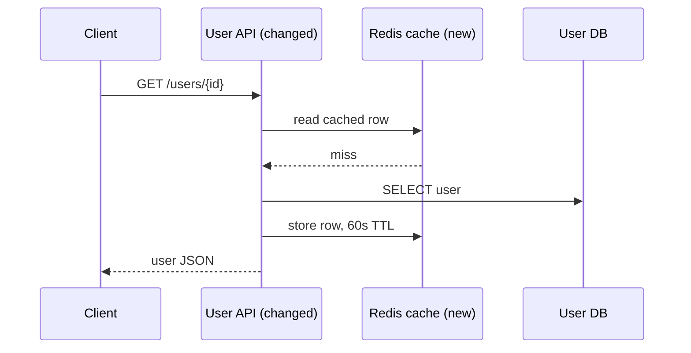
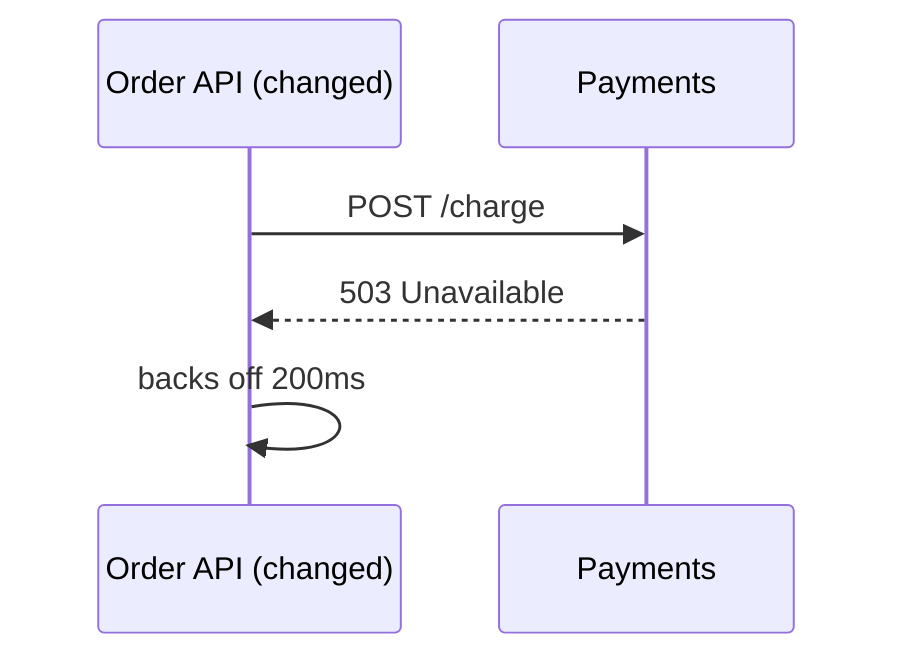

# Generate a Change Overview

lgtmaybe can post a
**[change overview](../reference/glossary.md#change-overview)** on a pull
request. It says what the change is, what is risky about it, and what it
touches. It is one comment, updated in place, for a reviewer to read before the
diff.

The overview is separate from the review. The review finds bugs in the lines it
reads. The overview describes the change as a whole.

## Contents

- [What You Get](#what-you-get)
- [High Impact Areas](#high-impact-areas)
- [Structure and Sequence](#structure-and-sequence)
- [On GitHub: `/diagram` and `auto_diagram`](#on-github-diagram-and-auto_diagram)
- [Locally: `lgtmaybe diagram`](#locally-lgtmaybe-diagram)
- [Why Mermaid (and What the ASCII Is For)](#why-mermaid-and-what-the-ascii-is-for)
- [See Also](#see-also)

## What You Get

One comment holds three model calls, run concurrently, plus one deterministic
section (worked out by code, with no model call). In reading order:

1. **The description head** (`auto_describe`): a suggested title, the change
   type, and a short summary.
2. **Risk of Change** (`risk`): the change's `low` to `critical` verdict and
   every reason behind it, computed without a model call. See
   [Risk of Change](../explanation/risk-of-change.md).
3. **[High Impact Areas](../reference/glossary.md#high-impact-areas)**
   (`high_impact`): the changes a reviewer must not miss. See
   [High Impact Areas](#high-impact-areas) below.
4. **The description detail** (`auto_describe`): a per-file walkthrough, and a
   "does it do what it says?" check when the PR states an intent.
5. **Up to two diagrams**: a Mermaid flowchart of the structure and, when the
   change alters one, a Mermaid sequence diagram of the run-time flow. Mermaid
   is a text format for diagrams that GitHub draws for you. Each diagram also
   comes as plain text. A terminal shows that text, and it is the fallback if
   the Mermaid can't be rendered.

The description, High Impact Areas and diagrams are three calls rather than
one. A single prompt doing three jobs does all three worse. The calls run at the
same time, so the overview takes about as long as its slowest call.

Each section has its own switch. The description and High Impact Areas are
best-effort: if one of those calls fails, its slot says so and the rest of the
comment still posts.

GitHub renders both Mermaid diagrams natively inside the comment, with no image
and no external hosting.

The flowchart is deliberately sparse:

- at most six components;
- short relationship labels;
- Mermaid's automatic layout.

Changed components are marked `(new)` or `(changed)` in their labels.

GitHub's renderer offers zoom buttons but no full screen. So each diagram is
followed by an **⛶ Open full screen** link. It opens the same diagram alone on
[mermaid.live](https://mermaid.live), with pan and zoom. The diagram source
travels compressed in the URL fragment and is decoded in your browser. Nothing
is sent anywhere until you click.

The diff is only a slice of the codebase. So a note under the diagrams calls
out any relationship the model inferred rather than saw in the diff.

Here is the posted comment for a PR that puts a Redis cache in front of a user
service. The Mermaid renders in place. Each text rendering sits in a collapsible
"Text version" underneath:

> ## Cache user lookups in Redis
>
> **Change type:** feature
>
> User reads now check Redis before PostgreSQL, and successful database reads
> populate the cache for later requests.

> ### **Risk of Change: Critical**
>
> - touches infrastructure: `infra/redis.tf`
> - touches backup and recovery: `ops/backup_retention.yaml`

> ### **High Impact Areas**
>
> - **Infrastructure**: New ElastiCache cluster (`infra/redis.tf`). Adds a
>   managed dependency to the production VPC. _Check:_ security group and
>   failover settings.
> - **Availability**: Cache on the user read path (`api/users.py`). User reads
>   now depend on Redis. A Redis outage takes reads down with it. _Check:_
>   confirm a Redis error falls back to the database.
> - **Backup and recovery**: touched `ops/backup_retention.yaml` (not assessed by
>   the model)

> ### Walkthrough
>
> | File | Change |
> |---|---|
> | `api/users.py` | Reads through the Redis cache before querying PostgreSQL |
> | `infra/redis.tf` | Adds an ElastiCache Redis cluster |
> | `ops/backup_retention.yaml` | Excludes the cache from nightly backups |

> ### Structure



> [⛶ Open full screen](https://mermaid.live)&nbsp; *(the real link carries the
> diagram source compressed into the URL)*

<details>
<summary>Text version</summary>

```
[Client] --requests--> [User API Python (changed)]
[User API Python (changed)] --checks--> [Redis cache Redis (new)]
[User API Python (changed)] --on miss--> [User DB PostgreSQL]
```

</details>

> ### Sequence



<details>
<summary>Text version</summary>

```
1. [Client] -> [User API (changed)]: GET /users/{id}
2. [User API (changed)] -> [Redis cache (new)]: read cached row
3. [Redis cache (new)] --> [User API (changed)]: miss
4. [User API (changed)] -> [User DB]: SELECT user
5. [User API (changed)] -> [Redis cache (new)]: store row, 60s TTL
6. [User API (changed)] --> [Client]: user JSON
```

</details>

> The User DB link is inferred from an import, not shown in the diff.

## High Impact Areas

A review reads the changed lines and tells you what is wrong in them. It cannot
tell you that halving a node count removes your peak headroom. Nor can it tell
you that the PR quietly shortened a backup retention policy.

**High Impact Areas** asks a different question: *what could this change break
beyond itself?* It answers in one section near the top of the overview.

Ten areas are checked:

| Area | What it covers |
|---|---|
| **Infrastructure** | IaC, Kubernetes/Helm, container images, CI/CD pipelines, deploy scripts, networking, DNS, load balancers, resource sizing |
| **Security** | Authentication, authorisation, IAM or permission scope, cryptography, secret handling, removed input validation, CORS/CSP/TLS, CI workflow permissions |
| **Availability** | Anything that could cause a production outage: startup and config defaults, timeouts, retries, circuit breakers, connection pools, rate limits, health checks, removed error handling, concurrency and locking, runtime or major dependency upgrades, hot-path performance, rollback and deploy ordering |
| **Data migration** | Schema or data migrations, destructive or irreversible data operations, backfills |
| **Backup and recovery** | Backup jobs, retention and lifecycle policies, snapshots, restore paths, disaster recovery, failover, replication |
| **Compatibility** | Breaking an external contract: HTTP APIs, event or message schemas, CLI flags, SDK surface, wire formats, feature-flag removal |
| **Observability** | Logs, metrics, alerts, dashboards, tracing, audit trails or runbooks being removed, silenced or changed |
| **Dependencies** | Supply chain: new dependencies, major bumps, loosened pins, lockfiles, base images, build toolchain |
| **Cost** | Autoscaling limits, instance types, provisioned capacity, storage classes, quotas |
| **Compliance** | PII or privacy handling, audit trails, data residency, licence changes |

Each call-out names:

- the area;
- a short headline;
- the files involved;
- the blast radius (what else the change can affect);
- the one thing a reviewer should verify.

A call-out the model rates `medium` or `critical` shows that severity next to
the area name. `high` is the unmarked default. Files the model names that the
PR never changed are dropped.

### The Path Floor

The model is not the only source. Before the call, lgtmaybe matches the PR's
changed paths against fixed patterns per area. Examples are `*.tf`,
`.github/workflows/`, `alembic/`, anything named for backups or retention, and
lockfiles. Those matches do two jobs:

- They are sent to the model as untrusted hints, saying where to look (never
  that anything is wrong).
- They floor the output. Say the model said nothing about a matched file under
  that area. The file is still listed, marked `(not assessed by the model)`. A
  weak model cannot make your Terraform change invisible.

The floor is also the fallback. If the call fails or returns nothing usable,
the section shows the path matches alone, under a "Model assessment
unavailable" note. The section degrades, but it never disappears.

When nothing qualifies, the section says so and names what it checked:

> ### **High Impact Areas**
>
> None detected. Checked: infrastructure, security posture, availability, data
> migrations, backups and recovery, compatibility, observability, dependencies,
> cost, compliance.

### Turning It Off

The section is on by default. To drop it and its model call:

```yaml
high_impact: false
```

The description has its own switch, `auto_describe: false`. Risk of Change has
`risk: {enabled: false}`. With all three off, the comment holds only the
diagrams and costs one call.

## Structure and Sequence

The two diagrams answer different questions, which is why lgtmaybe draws both:

| | Answers | Best on |
|---|---|---|
| **Flowchart** (structure) | What does this change touch, and what talks to what? | Structural PRs: a component added, a dependency introduced, a service split |
| **Sequence** | What happens at run time, in what order, and where did that change? | Behavioural PRs: a retry added, an ordering fixed, a signal now handled |

Most pull requests are behavioural, and structure alone under-describes them.
Take a PR that fixes terminal restoration on `SIGTERM`. It might touch two files
and draw three boxes. Its sequence diagram (signal, flag set, loop exit, guard
dropped, terminal restored) *is* the explanation of the fix.

A PR that puts a cache in front of a service is the opposite. The new box is the
headline, and the flow shows how a request now reaches it.

Some changes have no meaningful run-time flow, such as documentation,
configuration or formatting. For those, the sequence view is omitted rather
than invented. Both diagrams come from one model call and share the same
six-component budget. The sequence view adds at most eight ordered steps.

## On GitHub: `/diagram` and `auto_diagram`

Comment **`/diagram`** on a pull request to post the change overview, or update
it in place. Re-running edits the same comment instead of stacking new ones.
(`/describe` still posts the description alone as its own comment, for when
that is all you want.)

`auto_diagram` is on by default, with no workflow input or `.lgtmaybe.yml`
needed. The overview posts when a PR is opened or reopened. It refreshes after
each push, so every section tracks the head commit. To opt out of the whole
comment, set the input in your workflow:

```yaml
      - uses: MattJColes/lgtmaybe@v2
        with:
          provider: anthropic
          model: claude-sonnet-4-6
          api_key: ${{ secrets.ANTHROPIC_API_KEY }}
          auto_diagram: "false"
```

or in `.lgtmaybe.yml`:

```yaml
auto_diagram: false
```

The automatic overview stands back when the pull request already diagrams the
change. That means a fenced `mermaid` block in either:

- the PR description;
- any comment that is not this setup's own overview. That covers yours, a
  teammate's, another review bot's walkthrough, or another lgtmaybe setup's
  overview.

The review still runs, and its summary says where the existing diagram lives.
Once lgtmaybe has posted its own overview on a PR, it keeps refreshing that one
so it never goes stale. Comment `/diagram` to post the overview anyway: slash
commands skip the check.

Gitea runs the same check through the shared Action entrypoint. The
`gitlab-ci` command posts no automatic overview yet.

The description and High Impact Areas are best-effort. A failure is logged and
leaves a visible note in its slot. It never blocks the rest. The diagram is a
required completion step. So a failed diagram leaves the commit unfinished, and
the next run redoes it rather than skipping it.

## Locally: `lgtmaybe diagram`

`lgtmaybe diagram` prints the change overview of your local changes, with no
GitHub involved:

```console
$ lgtmaybe diagram --provider ollama --model llama3
```

It diffs your branch against the base, using the same base resolution as
`lgtmaybe review`:

- `--base` overrides the base;
- `--working` includes uncommitted edits;
- `--uncommitted` uses only the working-tree edits.

The output is the same body the `/diagram` comment carries. In order, that is
the description, Risk of Change, High Impact Areas and walkthrough. Then come
each diagram's Mermaid source, full-screen link and text rendering. There is one
change: a terminal renders no HTML. So the collapsible "Text version" wrapper
becomes a plain labelled section. An excerpt:

````console
$ lgtmaybe diagram --provider ollama --model llama3
...
### Sequence



[⛶ Open full screen](https://mermaid.live/view#pako:…)

Text version:

```
1. [Order API (changed)] -> [Payments]: POST /charge
2. [Payments] --> [Order API (changed)]: 503 Unavailable
3. [Order API (changed)] -> [Order API (changed)]: backs off 200ms
```
````

The Mermaid source stays in the output on purpose. Your terminal can't draw
it, but you can paste it into a GitHub comment,
[mermaid.live](https://mermaid.live), or a Markdown file to render it.

## Why Mermaid (and What the ASCII Is For)

GitHub renders **Mermaid** natively in comments and Markdown, both flowcharts
and sequence diagrams. So a `mermaid` fence renders in the comment, with no
image to generate or host.

That matters for a `pull_request_target` reviewer. Hosting an image would mean
committing a file or calling an external service. Neither fits a fork-safe
comment that is updated in place.

A terminal can't render Mermaid, which is why each diagram also comes as plain
text. In the GitHub comment, that text sits in a collapsible "Text version"
block, out of the way of the rendered diagram. In the terminal, the same block
becomes a labelled section, because HTML tags are noise in a shell. Either way,
the text is what you read without a renderer. It is also the fallback if a
diagram fails to render.

The model never writes Mermaid. It returns typed graph data: components,
relationships and ordered steps. lgtmaybe renders the syntax itself and escapes
every label. A diff that tries to smuggle diagram source or markup into a label
can't reach the fence.

D2 isn't used because GitHub doesn't render it in Markdown, so it would show as
source.

## See Also

- [Configure `.lgtmaybe.yml`](configure-lgtmaybe-yml.md)
- [Use as a GitHub Action](use-as-github-action.md)
- [Configuration reference](../reference/config.md)
